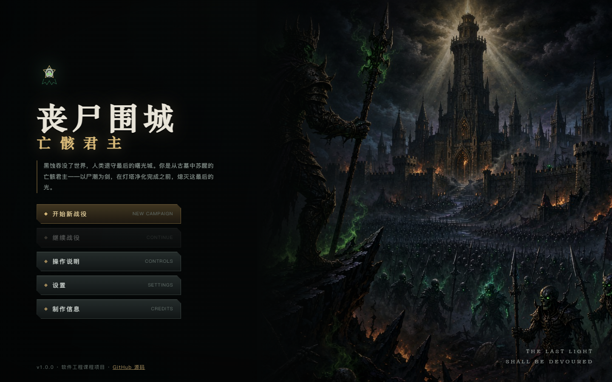
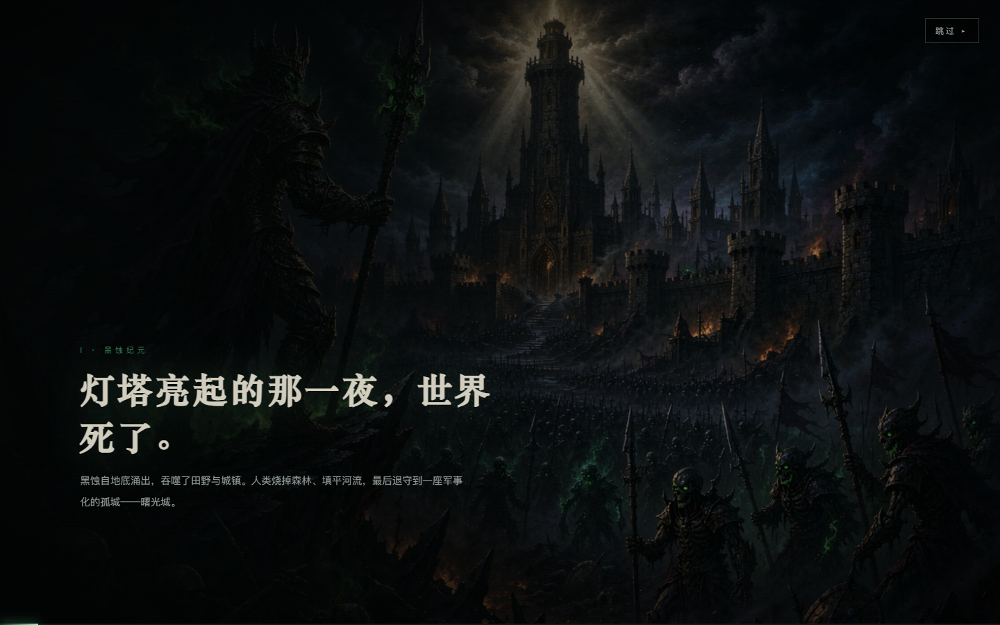
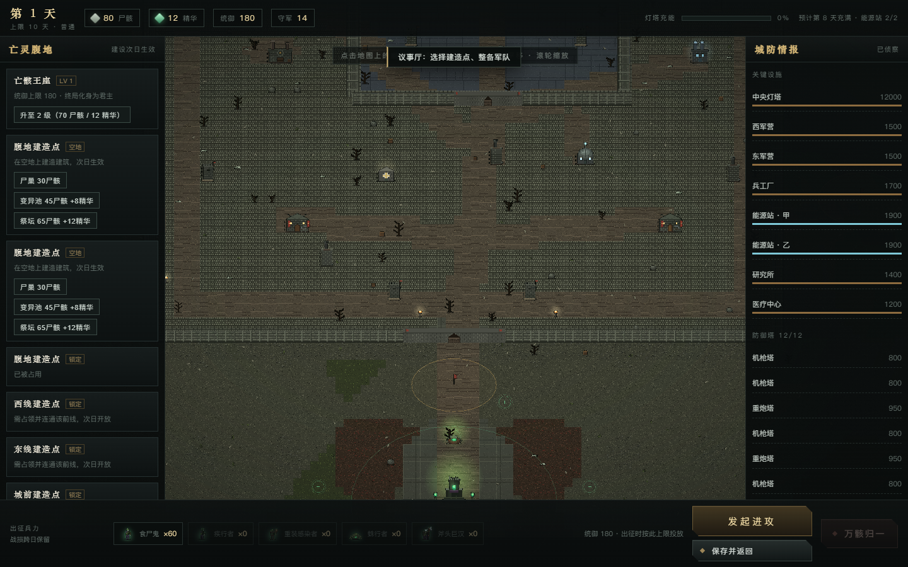
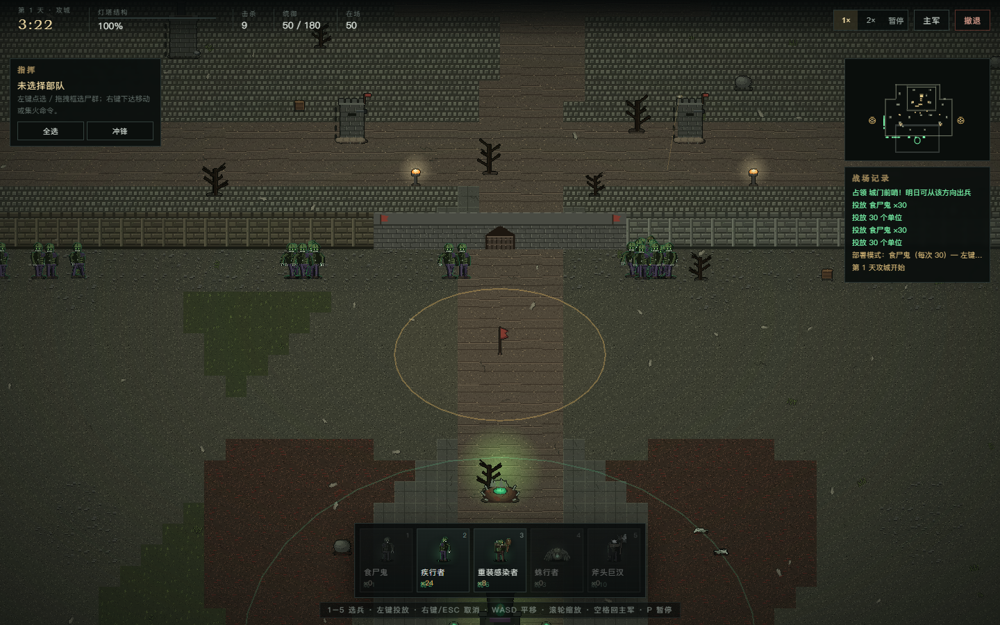
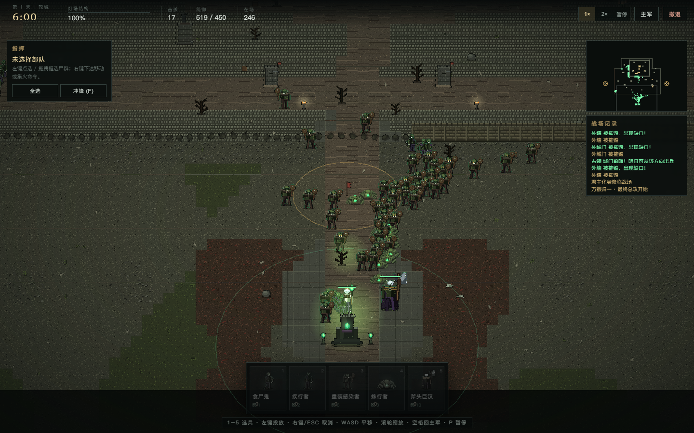
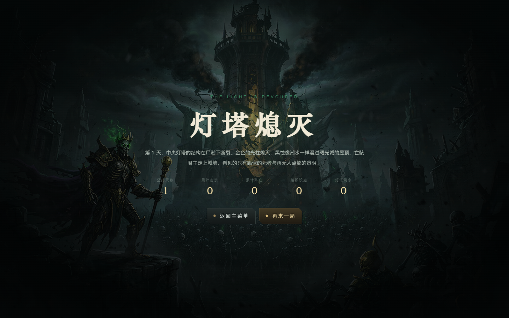

# 丧尸围城：亡骸君主

> **Zombie Siege: Ash Sovereign** — 暗黑奇幻像素风 · 单人攻城策略 · 软件工程课程项目

你从古墓中苏醒，是统御尸潮的亡骸君主。人类的最后之城「曙光城」以中央灯塔的净化之光抵挡黑蚀，你必须在其充能完成之前攻破城墙、摧毁灯塔——或者在最后关头发动不可逆的「万骸归一」，把整个亡灵王国烧成最后一支大军。

**🎮 在线游玩：https://liguanheng.github.io/SEAPP1/**

[](https://github.com/LiGuanheng/SEAPP1/actions/workflows/deploy.yml)


---

## 截图

| 主菜单 | 开场演出 |
|---|---|
|  |  |

| 议事厅（经营 / 建设 / 情报） | 攻城战（实时部署与破墙） |
|---|---|
|  |  |

| 万骸归一（终局总攻） | 胜利结局 |
|---|---|
|  |  |

---

## 玩法概览

| 系统 | 说明 |
|---|---|
| **多日战役** | 每日「议事厅建设 → 一次攻城 → 战报 → 人类发展 → 灯塔充能」。战果跨天保留。 |
| **双资源** | 尸骸（建造/招兵）、变异精华（精锐/祭坛）。所有收支进事件账本。 |
| **尸巢繁殖** | I/II/III 级每日 +12 / +22 / +35 食尸鬼，建设次日生效。 |
| **精锐改造** | 用**现有**食尸鬼 + 精华改造疾行者 / 重装感染者 / 蛛行者，绝不凭空生成。 |
| **实时攻城** | 卡片批量投放（30/12/4/8/1），自动索敌，右键集火/移动，框选，镜头平移缩放，1×/2× 倍速，暂停。 |
| **可破坏城防** | 外墙/城门/内墙分段 HP → 轻损 → 重损 → 缺口，缺口跨日永久存在。 |
| **前线争夺** | 清空守军并驻守 8 秒占领，次日解锁更靠前的部署区。 |
| **人类 AI** | 预算约束下补兵、修墙、建塔、研究；军营/兵工厂/能源站被毁会真实削弱其后劲。 |
| **终局** | 「万骸归一」献祭全部建筑与资源，君主化身登场，全军分批冲锋。 |
| **三种结局流程** | 提前胜利 / 充能满失败 / 终局失败，各有独立结局页。 |
| **存档** | localStorage + schemaVersion + 结构校验，坏档不白屏。 |
| **音效** | Web Audio 程序化合成（无外部音频文件），设置内可静音。 |

## 操作

| 按键 | 功能 |
|---|---|
| `1`–`5` | 选择兵种卡（进入部署模式） |
| 左键 | 部署模式下投放一批 / 空手时选择或框选单位 |
| 右键 | 命令移动或集火 / 部署模式下取消 |
| `WASD` · 滚轮 · 空格 | 平移镜头 · 缩放 · 回到主军 |
| `P` | 暂停 |
| `F` | 全军冲锋（自动投入剩余预备队） |
| `Esc` | 取消部署 / 取消选择 |

> 完整说明见 [docs/USER_MANUAL.md](docs/USER_MANUAL.md)。

## 技术栈

- **Phaser 3.90**：战场渲染、Tilemap、相机、动画
- **TypeScript 5.9**（strict）：战役逻辑与渲染分离，可在 Node 中直接测试
- **Vite 7**：开发与构建（生产 `base=/SEAPP1/`）
- **Vitest 3**：32 个单元 / 模拟测试
- **GitHub Actions + Pages**：CI 与静态部署（已上线）

## 本地运行

```bash
git clone https://github.com/LiGuanheng/SEAPP1.git
cd SEAPP1
npm ci
npm run dev        # http://localhost:5173
```

构建与测试：

```bash
npm run test       # Vitest：经济 / 战役 / 存档 / 战斗模拟（32 passed）
npm run build      # tsc --noEmit && vite build → dist/
npm run preview    # 预览生产构建
node scripts/smoke.mjs "https://liguanheng.github.io/SEAPP1/?nopause=1"   # 端到端冒烟
```

## 部署

1. 推送到 `main` 触发 `.github/workflows/deploy.yml`：`npm ci → npm run test → npm run build → deploy-pages`。
2. 仓库 **Settings → Pages → Source = GitHub Actions**（已配置）。
3. 线上地址：**https://liguanheng.github.io/SEAPP1/**

## 文档

| 文档 | 内容 |
|---|---|
| [docs/SRS.md](docs/SRS.md) | 需求规格（FR/NFR、验收条件） |
| [docs/SDD.md](docs/SDD.md) | 概要设计（架构、状态机、数据结构、系统设计） |
| [docs/TRACEABILITY.md](docs/TRACEABILITY.md) | 需求 → 代码 → 测试追溯矩阵 |
| [docs/TEST_REPORT.md](docs/TEST_REPORT.md) | 测试结果、性能记录与已知缺陷 |
| [docs/DECISIONS.md](docs/DECISIONS.md) | 技术取舍与待学生验收项 |
| [docs/DEV_LOG.md](docs/DEV_LOG.md) | 分阶段开发日志与 commit |
| [docs/AI_COLLABORATION.md](docs/AI_COLLABORATION.md) | 人机协作真实记录 |
| [docs/ASSET_LICENSES.md](docs/ASSET_LICENSES.md) | 素材来源与许可 |
| [docs/USER_MANUAL.md](docs/USER_MANUAL.md) | 玩家手册与 FAQ |
| [docs/BALANCE_NOTES.md](docs/BALANCE_NOTES.md) | 数值与调参记录 |

## 项目结构

```text
src/
  config/     数值、地图、版本
  core/       战役状态、经济、日结算、存档（纯 TS，可测试）
  battle/     流场寻路、实时战斗模拟（可 headless 运行）
  art/        程序化像素素材（地形/单位/建筑/特效）
  game/       Phaser 场景、纹理注册、输入、镜头
  ui/         DOM 界面（菜单/议事厅/HUD/战报/结局）
  audio.ts    Web Audio 程序化音效
docs/         课程文档与截图
tests/        Vitest 测试（32 个用例）
scripts/      截图与端到端冒烟工具
```

## 功能范围（V1 交付）

**已实现**：4 种亡灵兵种（食尸鬼/疾行者/重装/蛛行者）+ 斧头巨汉 Boss、君主化身、3 条攻城路线与 3 个前线、2 座能源站、军营/兵工厂/研究所/医疗中心、8 座初始防御塔 + 人类 AI 新建塔、多日战役、人类预算 AI、灯塔倒计时、终局献祭、全军冲锋、3 难度、存档、双结局、程序化音效。

**未实现（留给 Codex 扩展）**：亡灵法师、腐鸦、蜘蛛女皇/亡灵骑士/腐羽巨鸟、完整 6 建筑科技树、人类预备队复杂调防与反攻前线、450–500 同屏高精度 AI、多地图与剧情分支、3× 倍速与编队。

> 详细差异见 [docs/SRS.md §1.3](docs/SRS.md) 与 [docs/TEST_REPORT.md §6](docs/TEST_REPORT.md)。**V1 没有宣称完成的部分，文档中一律标为未实现。**

## 声明

本项目为原创作品：角色、城邦与剧情均为原创，未使用任何商业 IP 的角色、名称或素材；战场像素素材由源码程序化绘制，关键视觉由 AI 图像模型生成后人工筛选，详见 [docs/ASSET_LICENSES.md](docs/ASSET_LICENSES.md)。

课程具体评分细则以任课教师正式任务书为准，本项目不虚构未提供的评分标准。
