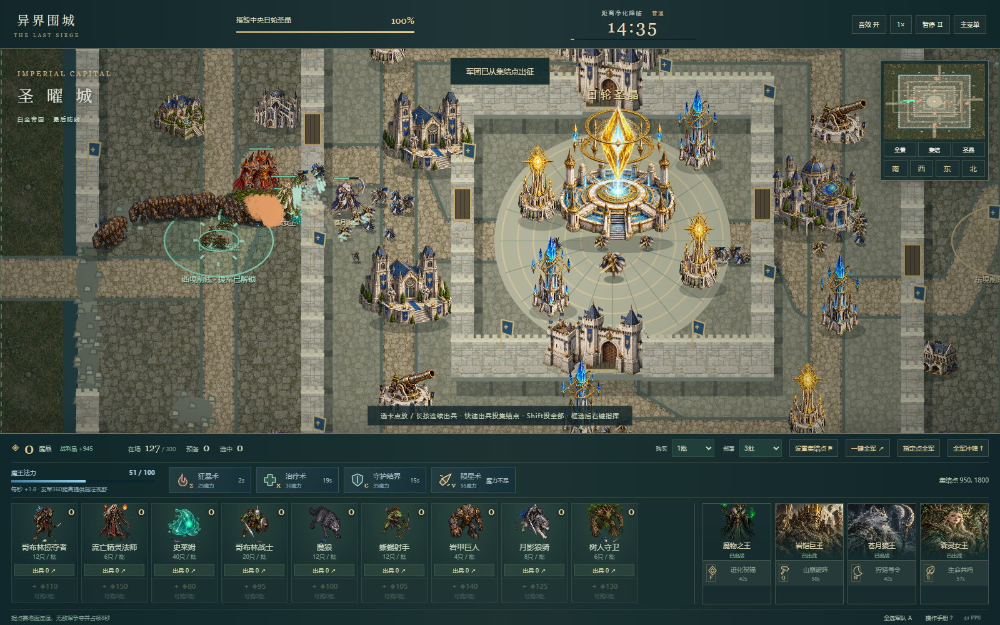

# 异界围城：魔物之王

原创奇幻军团实时攻城 · 软件工程课程项目 V3

**[在线游玩](https://liguanheng.github.io/SEAPP1/)** · [本轮交付与实测](docs/v3/REPORT.md) · [操作手册](docs/USER_MANUAL.md) · [真实截图](docs/screenshots/v3)

从东、南、西、北四面集结，掠夺外围资源，突破外城、内城与中央核心。唯一目标始终是摧毁日轮圣晶；无需清除建筑清单，没有多日经营和基地建设。

## 下兵更快

- 默认一次 **3批**，可调 **1 / 3 / 5 / 10批 / 全部库存**。
- 选中兵种卡后反复点地图；**按住同一位置连续出兵**，松开、暂停、取消或失焦即停止。
- 设置合法集结点后，点卡片下方 **出兵** 按钮即可一键投放，**Shift+点击投全部**；也可一键投入全军。
- 保留原生拖放与英雄点放。库存只扣一次；召唤约100只/秒，300只以外完整排队。



## 本轮重制

4000×3600的四面战场，外围/外城/内城/核心四层防区、三重真实可破坏围墙、四座前线、不同方向的城防组合。守军有警戒与归位，有限预备队开局即存在，按压力沿城门与道路引导增援；射程、目标类型与真实墙体/建筑遮挡共同决定攻击。

保留三专精、六统帅及手动主动技能，扩展为十二兵种。哥布林掠夺者优先近处资源、额外一次性收益；流亡精灵法师有施法前摇与真实范围焰爆。新增Z/X/C/V四种魔王法术和法力恢复，支持点击、拖放、范围预览与冷却反馈。

圣晶仍为5600HP。难度靠布局、数量有限的守军/预备队和不同压力构成，未使用巨额核心生命或无限刷兵。

## 本地运行

Node.js 22+：

```sh
npm ci
npm run dev
```

```sh
npm run test
npm run typecheck
npm run format:check
npm run build
npm run preview -- --host 127.0.0.1 --port 4173
npm run test:e2e -- http://127.0.0.1:4173/SEAPP1/
npm run sim
```

生产预览路径为 `/SEAPP1/`。浏览器脚本需要本机Chrome或Edge，支持CHROME_PATH。Windows干净安装前应停止本项目预览，以释放esbuild文件锁。

实测使用真实菜单、购买、部署、键鼠施法及同一固定60Hz战斗模型；长战役采用模拟快进，不冒充人类实时盲测。原始JSON、失败样本、性能环境及截图见验收报告。

## 课程资料

[GDD](docs/GDD.md) · [SRS](docs/SRS.md) · [SDD](docs/SDD.md) · [追溯矩阵](docs/TRACEABILITY.md) · [测试报告](docs/TEST_REPORT.md) · [开发日志](docs/DEV_LOG.md) · [决策](docs/DECISIONS.md) · [AI协作](docs/AI_COLLABORATION.md) · [资源与提示词](docs/ASSET_LICENSES.md) · [部署](docs/DEPLOYMENT.md) · [演示流程](docs/DEMO.md)

TypeScript、Vite、原生Canvas 2D与DOM；AI完全为本地规则，不调用大模型API。原创图片PNG在art-source，正式使用WebP。动画仍以两姿态及程序化动作呈现，移动端、中途存档、完整BGM和低端设备盲测不在已验证范围。

V1、V2课程材料原样归档在docs/archive；旧版真实实测仍保留。全部Git历史正常延续，不强推、不改旧提交时间。公开构建含build-manifest.json，可核验源提交及每个文件的SHA-256。
