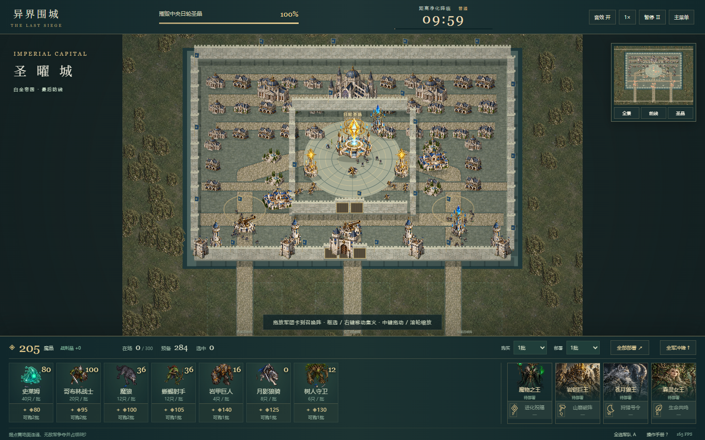
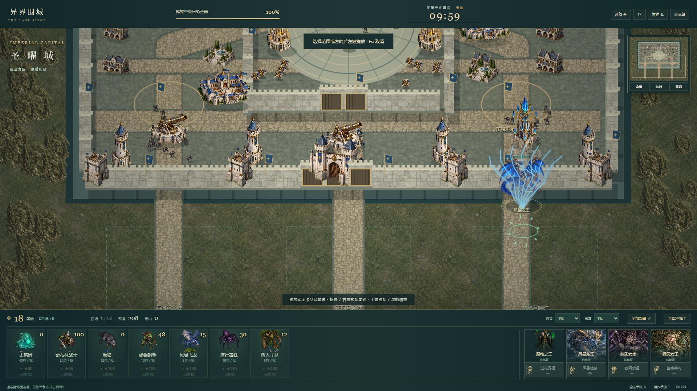

# 异界围城：魔物之王

原创奇幻魔物军团实时攻城游戏 · 软件工程课程项目 V2

**[在线游玩](https://liguanheng.github.io/SEAPP1/)** · [验收报告](docs/V2_REPORT.md) · [玩家手册](docs/USER_MANUAL.md) · [真实截图](docs/screenshots/v2)

选择魔王专精和最多四位统帅，用有限魔晶购买军团，从三路城外召唤，破墙、夺取前线、用战利品补兵，在日轮圣晶完成净化前摧毁它。开局就是最后总攻，没有多日经营或基地建设。



## 游戏内容

- 三种专精、六位独立魔物统帅、十种可辨兵种与手动技能。
- 原生拖放、批量/全部库存、活动300上限与无丢失排队；战前/战中独立购买。
- 可破坏的两层城墙、炮火与防空、有限守军/预备队、两个8秒前线据点。
- 框选、右键移动/集火、编队、暂停/倍速；完整胜利、超时、力竭和重试。
- 原创插画、精灵和城防美术，事件驱动召唤、巨王破墙、龙息、陨星与圣晶演出。



## 运行与验证

Node.js 22+：

```sh
npm ci
npm run dev
```

```sh
npm run typecheck
npm run format:check
npm run test
npm run build
npm run preview -- --host 127.0.0.1 --port 4173
```

生产预览访问 `http://127.0.0.1:4173/SEAPP1/`。Windows干净安装前应先停止本项目预览服务以释放esbuild文件锁。

安装Chrome/Edge后，可执行 `npm run test:e2e -- http://127.0.0.1:4173/SEAPP1/` 和 `npm run sim`。浏览器脚本支持CHROME_PATH。最终新版48项逻辑测试、36项真实浏览器检查、固定种子策略与300单位实测分别留证，详见报告；没有把构建成功冒充试玩通过。

主要操作：卡片拖到合法区域；左键框选、右键移动/集火，A全选，Ctrl+1–3保存编队，Q/W/E/R统帅技能、F魔王技能，空格暂停，中键拖镜头、滚轮缩放。

## 课程资料与来源

[SRS](docs/SRS.md) · [SDD](docs/SDD.md) · [需求追溯](docs/TRACEABILITY.md) · [测试报告](docs/TEST_REPORT.md) · [开发日志](docs/DEV_LOG.md) · [决策](docs/DECISIONS.md) · [AI协作](docs/AI_COLLABORATION.md) · [资源登记](docs/ASSET_LICENSES.md) · [部署](docs/DEPLOYMENT.md) · [课堂演示](docs/DEMO.md)

采用TypeScript、Vite、原生Canvas 2D与DOM；战斗AI是有限本地规则，不接大模型API。原始美术保留在art-source，正式资源编码为WebP；没有挪用商业游戏素材。动作仍以两姿态和程序化变形为主，完整方向动画、可破坏民居和独立人类平衡盲测仍有提升空间。

V1历史基线d4aa44d与完整Git历史保留，旧资料在docs/archive/v1。M0–M6按真实阶段正常提交推送，没有强推或伪造历史。正式构建包含build-manifest.json，便于核对部署提交和资源SHA-256。
