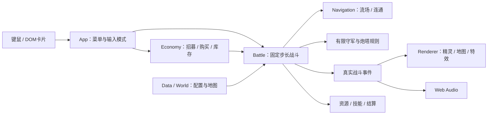
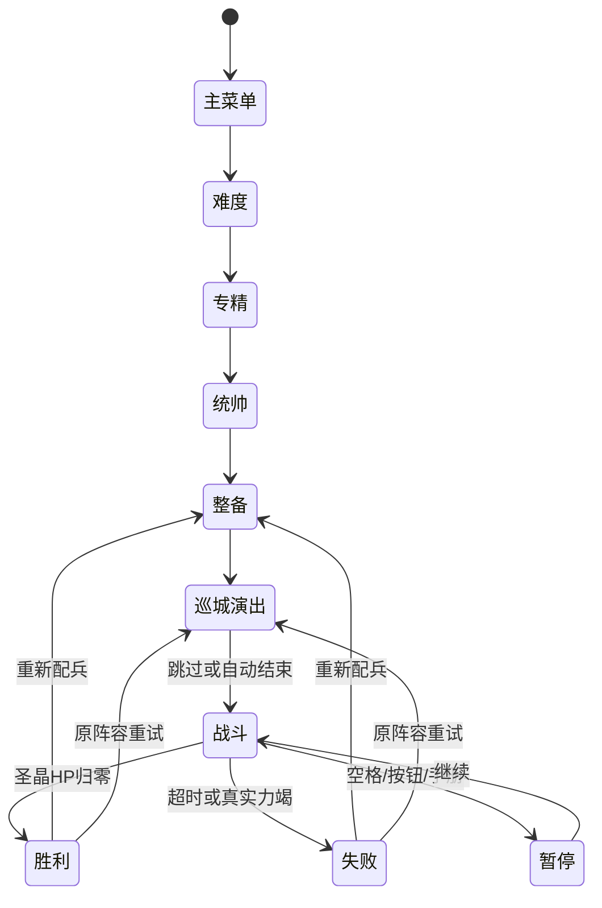

# V2 软件设计说明书

日期：2026-10-24｜对应SRS V2.0

## 1. 架构

采用TypeScript + Vite、原生Canvas 2D和DOM界面。旧Phaser经营架构已退出运行。选择原生绘制是为了让确定性战斗能直接在Node中验证，并便于分层手绘素材、流场、批量兵力和DOM卡片统一协作；不是沿用旧系统改标题。

| 模块 | 责任 |
|---|---|
| `src/v2/data.ts` | 三难度、三专精、六统帅、十兵种、人类属性与世界常量 |
| `economy.ts` | 纯账本、解锁、招募、购买、退款、推荐阵容 |
| `world.ts` | 可破坏结构与前线控制区的静态布局 |
| `navigation.ts` | 40px网格、共享Dijkstra场、物理阻挡、地面连通查询 |
| `simulation.ts` | 实体、60Hz更新、队列、攻击/弹道、技能、AI、占领、奖励与胜败 |
| `render.ts` | 摄像机、缓存地表、独立角色/建筑、按深度排序、动作与事件粒子、小地图 |
| `app.ts` | 四步整备、底栏、互斥输入模式、原生拖放、编队、战报与生命周期 |
| `sound.ts` | 用户手势后的合成音效、噪声冲击与V2静音设置 |

## 2. 状态与时钟

`advance(realSeconds)`把有效时间累计到60Hz固定更新，不依赖显示刷新率。暂停不累计；2×同时放大模拟与倒计时。胜败只在同一个模型中判断，圣晶先于超时/力竭。对小于1e-6秒的机器误差归零，避免结算时残留“1秒”。渲染允许独立刷新，背景页不追赶巨大时间步。

每场Battle拥有唯一递增ID、独立种子、结构/单位、库存副本、技能计时、占领奖励和统计。重试从战前配置深拷贝构造新Battle；不读取V1存档或复制战中损毁。

## 3. 经济与部署事务

购买顺序：检查兵种解锁与可购批数→计算整批价格→单次扣款→单次入库存。同步事务不包含异步回调，快速点击不会使余额透支。招募上限和每英雄一次出场由名单/Set约束。

部署顺序：检查战斗状态与合法点→取批数和库存的较小值→扣库存→加入带数量的队列。购买和部署分开。每约35ms从队列发出一个真实单位；活动友军达到300便等待，分裂、免费技能也进入同一队列。没有因达到上限而吞掉库存的分支。

初始只允许三处城外区域。前线需被占领、地面连通、未争夺，并避开敌军和中央300px禁投圈。飞行军只能战斗，不能单独触发地面占领。控制圈站稳8个仿真秒奖励一次200，之后可以在前线购买并部署实际库存。

## 4. 导航、指挥与AI

导航把墙/门视为高代价“可攻城通道”，但物理移动仍由存活结构阻挡。单位到达阻挡处攻击该段，破坏后立即重建碰撞与共享流场。薄弱墙代价更低；巨人对墙×4；飞行忽略实体；毒蛛只能忽略标记薄弱段。Float32松弛使用最小改进阈值，避免等价路径重复入队。

默认地面部队向本路据点/核心推进。右键移动使用共享中心流场与末端队形，到位保持驻留；右键指定目标持续集火，目标死亡后恢复正常行为。全军冲锋解除驻留，同时保留指定攻击。1–3编队存真实ID，回选过滤阵亡者。

人类规则完全在本地：驻守与有限追击、近战不能对空、弓手与法师远程、骑士克制狼类、重炮选密集地面、对空塔只射飞行、圣光优先高价值英雄。最多三波预备队从存活军营门口实际生成，沿街道集结到防线；军营毁损不会延长倒计时，也不会无限刷新。

## 5. 美术、反馈与性能

原创PNG源在 `art-source/`，发布使用 `public/art/*.webp`，图集编码与尺寸登记可重现。六英雄独立图片，普通兵两姿态图集，配合翻转、跳动、位移、攻击摆动、受击、死亡淡出。军事设施是战斗结构，裂纹/坍塌与碰撞同步；街区民居、圣殿和环境为烘焙装饰，尚不作为可破坏战术建筑。

战斗事件驱动召唤、追踪弹、地面锁定炮弹、破墙碎石、扇形龙息、治疗、蛛网、陨星和圣晶结局。预览使用相同半径/扇形，单位的普通攻击不替玩家自动施放主动技能。

性能手段包括180px空间分桶、低频重选目标、共享流场、48场导航缓存上限、活动300限制、帧素材缓存、静态地表Canvas、镜头外裁剪和350特效上限。销毁时取消RAF、断开ResizeObserver、清空大画布并abort输入监听。通过实际旧场景停止推进及键盘不再响应的检查验证生命周期。

## 6. 验证接口与限制

`window.__SIEGE__`是浏览器验收入口，提供真实Battle/Renderer与合法推荐配置。脚本可推进同一模拟以缩短长战斗等待；不会据此直接修改HP/资金来制造胜利。业务测试在Node运行，UI测试使用本机Chrome真实拖放和键鼠。

目前不包含完整多方向骨骼动画、可破坏民居、战斗中存档、手机触控、音轨BGM、独立人类盲测或中低端设备覆盖。它们不会被作为已完成项目列入报告。
