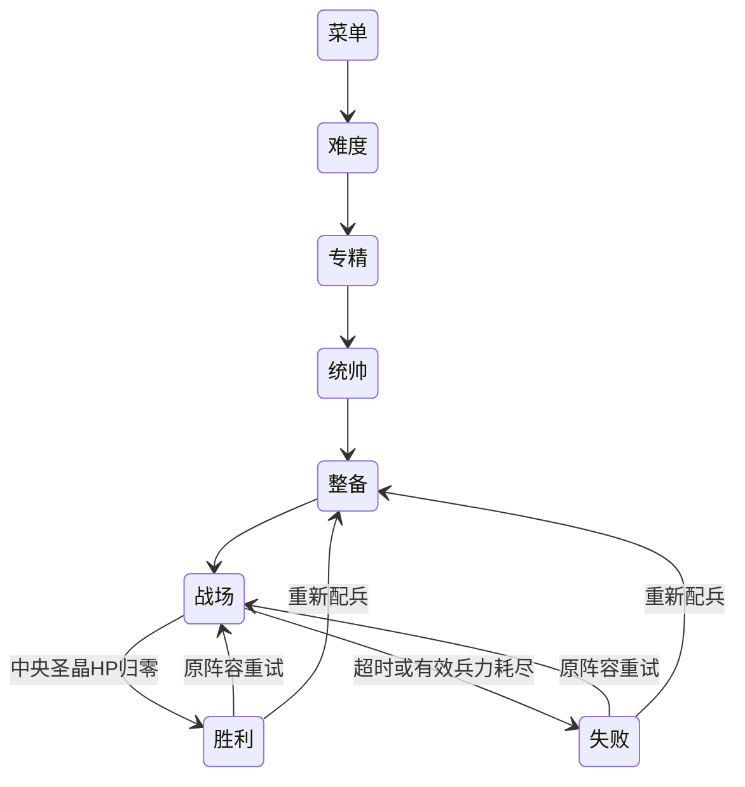

# 软件设计说明 V3

2026-10-24。采用TypeScript、原生Canvas 2D、DOM和Vite。src/v2保留既有目录名以避免无意义重命名；其代码已是V3，正式版本由package.json和构建清单标记。

## 模块与状态

| 模块 | 职责 |
|---|---|
| data.ts | 三难度、三专精、十二兵种、六统帅、四法术及世界尺寸 |
| world.ts | 三个闭合围墙环、十二城门、四前线、四方向差异资源与军事/市政结构、防区 |
| economy.ts | 原子预算/招募/购买/退款/库存/预设 |
| navigation.ts | 40px空间栅格、加权共享Dijkstra、物理矩形碰撞、精确线段/矩形遮挡、48场缓存 |
| simulation.ts | 固定60Hz模型、军队与投射物、规则城防、有限预备队、魔力/法术、奖励/前线/胜败 |
| deployment.ts | 立即点放及长按连投状态，不拥有独立计时器，由渲染循环提供单调时间 |
| render.ts | 原创图集、缓存地面、可破坏实体、动作/演出、范围预览、小地图、受约束镜头 |
| app.ts | 菜单/整备/固定HUD、原生拖放、框选/命令/编队、法术输入、释放/失焦取消与生命周期 |
| sound.ts | 本地WebAudio合成音效与静音偏好 |

## 导航、视线与军事纵深

结构有独立ID/真实矩形/HP、防区、方向、资源属性及paid标记。环墙四角连续拼接，四门是有HP的实体。友军导航可按破墙代价选择缺口，蜘蛛仅能越薄弱段；敌方通过己方城门但不能穿实体城墙。破坏使碰撞/场缓存失效，重建后重新判定前线连通。

空间桶用于邻近单位与障碍候选。视线对候选执行线段与真实矩形相交，不以“距离近”替代视野。射程到结构按矩形最近表面计算；目标本体从遮挡候选中排除，其前方其他墙/建筑仍阻挡。远程弹道命中前重查路径，范围伤害由爆心对受害者重查遮挡。飞行可移动越墙，不能隔完整墙凭空攻击里面的目标。

固定塔同时检验射程、类型、防区和遮挡；防空范围齐射只伤飞行目标。普通守军只在警戒范围迎敌，敌军离开后归位。预备队在构造时已建立实体小队，简单2×6、普通3×6、困难4×7；调动选择当前压力最高且不过量支援的方向，先经过真实内城城门再向前线移动，不由计时器产生新单位。

## 战斗与经济事务

购买扣款→库存增加；合法部署扣库存→队列增加；队列按约100只/秒、最多300活动友军入场。三个阶段分别计账，无部署再次扣款。连投只重复同一合法部署操作，英雄和全部库存不重复；撤销/失焦没有后台定时器遗留。

每个结构死亡只结算一次。资源奖励的基础部分加上掠夺者击毁奖励，在paid由false转true时一起发放。前线捕获只发一次200，争夺或不连通时禁投。记录deployed/lost/income/walls/resourceIncome/spells和各防区开火/破坏次数，用于真实验收。

精灵攻击有咏唱阶段，目标阵亡/超距/失去视线会中止；投射物延迟与范围伤害由模型处理。四法术共享魔力、各自冷却和区域对象；治疗只恢复活体，守护参与真实伤害计算，陨星有0.9秒预警和对圣晶限制。统帅与专精F的旧技能独立保留。

## 生命周期、性能和发布

60Hz累积器与渲染帧率分离；暂停冻结战斗、倒计时、魔力与冷却。300活动上限之外保留队列。图集裁切和受击alpha蒙版按帧缓存，静态地面一次绘制；常规满血单位缩远或全选时不堆叠血条，保持军团可读性。

离开战场取消RAF、ResizeObserver和AbortController所属输入监听，清空临时效果与地面缓存。长按状态由同一渲染生命周期驱动，不能在重试后的新战役中继续扣库存。

生产base为/SEAPP1/，开发为根路径。构建清单记录版本、源SHA、干净状态及每个文件SHA-256。CI干净安装、测试、格式与构建后发布Pages；文档和美术源文件变动不触发无关部署。线上验收实际打开公开URL并比对全部文件。

## 已知设计边界

人群采用轻量分离而非完整刚体；常规动作主要两姿态与程序化变形。森林、铺装和部分废墟为视觉装饰；主要民居、军事建筑、资源和墙为实体。没有中途存档、移动触控、完整BGM或第三方真人平衡盲测。详细性能环境和失败记录见v3/REPORT。
