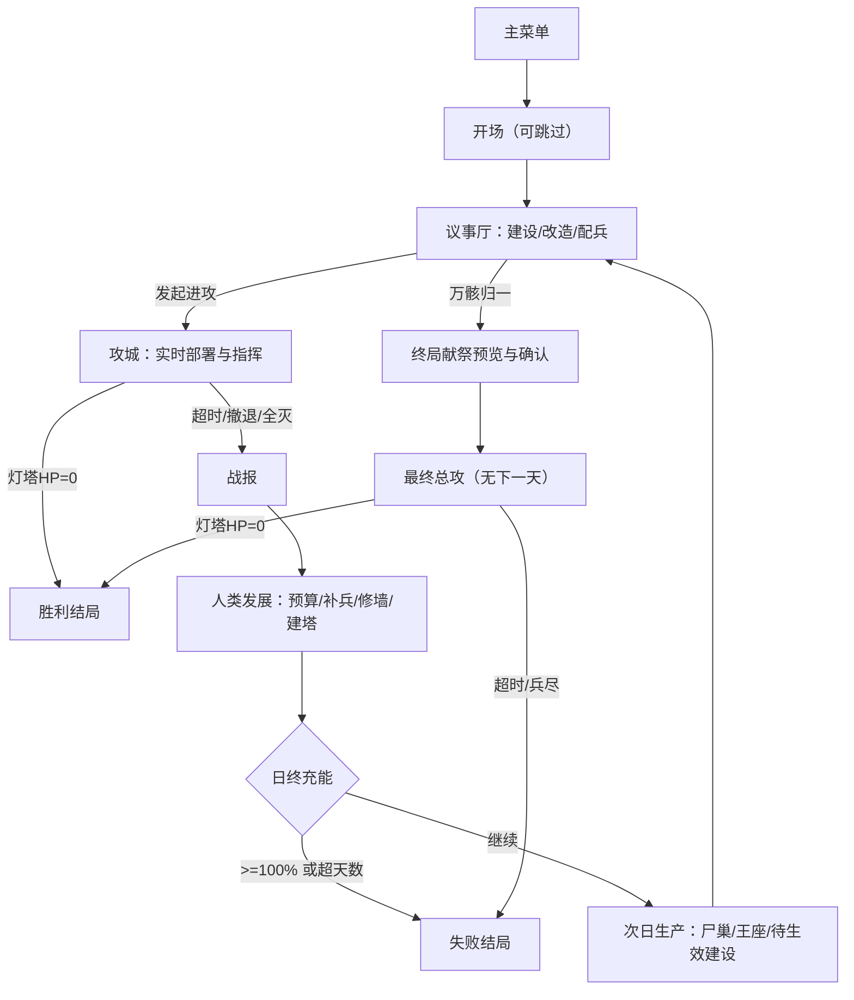

# 软件概要设计说明书（SDD）

**项目**：《丧尸围城：亡骸君主》
**版本**：1.0
**日期**：2026-10-24
**状态**：随源码迭代维护（本文档描述的是**实际实现**，与代码不一致时以代码为准并回写文档）

---

## 1. 架构总览

设计目标：**确定性战役逻辑与 Phaser 渲染层分离**，使核心规则可在 Node 环境用 Vitest 直接测试，不依赖浏览器。

```
┌────────────────────────────── 浏览器 ──────────────────────────────┐
│  index.html                                                        │
│  ├─ #game-container  ← Phaser Canvas（战场 / 议事厅地图 / 开场）      │
│  └─ #ui-root         ← DOM UI 层（菜单 / 议事厅 / HUD / 战报 / 结局） │
├──────────────────────────────┬─────────────────────────────────────┤
│  表现层 src/game, src/art     │  交互层 src/ui, 场景输入              │
│  WorldScene / 程序化像素素材   │  卡片部署 / 框选 / 镜头 / 键盘        │
├──────────────────────────────┴─────────────────────────────────────┤
│  领域层 src/core（纯 TS，无 Phaser）                                │
│  campaign（日流程/人类AI/灯塔/献祭） economy（繁殖/改造/建造）        │
│  state（不变量/账本）  save（版本化存档）                            │
├────────────────────────────────────────────────────────────────────┤
│  战斗层 src/battle（纯 TS）                                         │
│  nav（瓦片网格 + 流场寻路）  sim（单位/结构/塔/伤害/占点）            │
├────────────────────────────────────────────────────────────────────┤
│  配置 src/config：balance.ts（全部数值） mapData.ts（地图与设施坐标） │
└────────────────────────────────────────────────────────────────────┘
```

**关键决策**：UI 不引入 React/Vue。菜单、议事厅、HUD 用原生 DOM + CSS 构建，战场用 Phaser。理由见 `docs/DECISIONS.md` D-02。

### 1.1 目录结构

```text
SEAPP1/
├─ src/
│  ├─ main.ts                 入口：创建 Shell，显示主菜单
│  ├─ style.css               全部 UI 样式（暗黑骨金 / 幽绿主题）
│  ├─ config/
│  │  ├─ balance.ts           单位/建筑/塔/难度/时间等全部数值
│  │  ├─ mapData.ts           地图尺寸、地形、墙段、设施、据点、建造槽
│  │  └─ version.ts           版本号、存档键、schemaVersion
│  ├─ core/
│  │  ├─ types.ts             CampaignState / UnitStack / Phase 等
│  │  ├─ state.ts             新开局状态、不变量校验、账本
│  │  ├─ economy.ts           繁殖、建造、改造、统御
│  │  ├─ campaign.ts          日流程、人类 AI、灯塔、终局献祭
│  │  └─ save.ts              localStorage 读写与坏档恢复
│  ├─ battle/
│  │  ├─ nav.ts               网格与流场（Dijkstra）
│  │  └─ sim.ts               实时战斗模拟（可 headless 运行）
│  ├─ art/
│  │  ├─ pixel.ts             像素画布与调色板
│  │  ├─ units.ts             单位精灵（多帧动画）
│  │  ├─ tiles.ts             地形瓦片集
│  │  ├─ buildings.ts         建筑与墙段
│  │  └─ fx.ts                特效贴图
│  ├─ game/
│  │  └─ WorldScene.ts        地图渲染、镜头、输入、单位视觉同步
│  ├─ ui/
│  │  ├─ shell.ts             屏幕路由、模态、Toast
│  │  ├─ dom.ts               DOM 构建工具
│  │  ├─ settings.ts          音量/画质设置
│  │  ├─ screens.ts           议事厅 / HUD / 战报 / 结局
│  │  └─ intro.ts             开场演出
│  └─ persistence/            （如拆分独立存档模块）
├─ public/assets/art/         AI 生成关键视觉（菜单/结局）
├─ tests/                     Vitest 单元与模拟测试
├─ docs/                      课程文档
└─ .github/workflows/deploy.yml
```

---

## 2. 状态机与回合顺序



### 2.1 日结算严格顺序（`core/campaign.ts#advanceDay`）

1. `applyBattleResult`（由战报确认后调用，只执行一次）
2. `humanTurn`：预算入账 → 修墙 → 补兵 → 建塔 → 反攻判定
3. `chargeCheck`：`charge += base + perStation × 存活能源站数`
4. 判定：`charge >= 100` → 失败；`day >= maxDays` 且当日未胜 → 失败
5. `produce`：尸巢产兵、王座产尸骸、待生效建造转正、人类训练入队
6. `day++` → `phase = council`

**幂等性**：`advanceDay` 首行检查 `state.dayAdvanced` 标志（结算后置位，进入议事厅时清除），重复调用直接返回，避免刷新或场景重建导致双倍结算。

---

## 3. 数据模型（实际实现）

```ts
type Phase = 'menu' | 'council' | 'battle' | 'report' | 'won' | 'lost';
type UnitType = 'zombie' | 'runner' | 'brute' | 'spider' | 'boss';
type UndeadBuildingKind = 'brood' | 'mutation' | 'altar';
type HumanFacilityKind = 'barracks' | 'arsenal' | 'power' | 'research' | 'medical' | 'lighthouse';

interface CampaignState {
  schemaVersion: number;
  seed: number;
  day: number;
  maxDays: number;
  difficulty: 'easy' | 'normal' | 'hard';
  phase: Phase;
  resources: { corpses: number; essence: number };
  inventory: Record<UnitType, number>;
  casualties: Record<UnitType, number>;
  kills: number;
  converted: number;
  throneLevel: 1 | 2 | 3;
  buildings: UndeadBuilding[];        // 含槽位坐标、等级、pendingLevel、destroyed
  human: HumanFacility[];             // 含 hp/maxHp/destroyed/level
  walls: WallSegmentState[];          // 含 hp、destroyed、damageState
  territories: TerritoryState[];      // owner / capturedOnDay / activeForDeploy
  lighthouse: { hp: number; maxHp: number; charge: number };
  humanBudget: number;
  humanSoldiers: number;
  techLevel: number;
  boss: { unlocked: boolean; woundedDay: number | null };
  finalAssaultTriggered: boolean;
  finalPreview: SacrificePreview | null;
  pending: PendingOrder[];            // 次日生效的建造
  ledger: GameEvent[];
  stats: { deployed: number; lost: number; structuresDestroyed: number; daysPlayed: number };
  flags: { dayAdvanced: boolean; introSeen: boolean };
}

interface UnitStack { zombie: number; runner: number; brute: number; spider: number; boss: number; }
```

### 3.1 必须成立的不变量（`core/state.ts#validateState`）

- 所有资源与库存 `>= 0` 且为有限数。
- `lighthouse.charge ∈ [0, 100]`，`hp ∈ [0, maxHp]`。
- `walls[i].destroyed === true` 的段永久不可修复（`repairWall` 直接拒绝）。
- 已 `destroyed` 的人类设施不再产出、不再射击。
- `finalAssaultTriggered === false` 时才能生成献祭预览。
- 每日充能最多结算一次（`flags.dayAdvanced`）。
- 部署时 `deployedCommandCost <= commandCapacity`（终局除外）。

### 3.2 事件账本

每笔资源变动 append 一条：

```ts
interface GameEvent {
  id: number; day: number;
  type: 'produce' | 'build' | 'upgrade' | 'convert' | 'deploy' | 'return' |
        'casualty' | 'loot' | 'human-train' | 'charge' | 'sacrifice' | 'capture';
  detail: string;
  corpses?: number; essence?: number;
  unit?: UnitType; count?: number;
}
```

账本用于战报、调试与后续不变量校验，不参与胜负计算。

---

## 4. 关键系统设计

### 4.1 经济与繁殖（`core/economy.ts`）

| 行动 | 成本 | 生效 |
|---|---|---|
| 建 I 级尸巢 | 30 尸骸 | 次日 |
| 尸巢 I→II | 45 尸骸 | 次日 |
| 尸巢 II→III | 65 尸骸 + 10 精华 | 次日 |
| 建变异池 | 45 尸骸 + 8 精华 | 次日 |
| 变异池 II | 70 尸骸 + 15 精华 | 次日 |
| 建黑暗祭坛 | 65 尸骸 + 12 精华 | 次日 |
| 王座 I→II | 70 尸骸 + 12 精华 | 次日 |
| 王座 II→III | 130 尸骸 + 25 精华 | 次日 |
| 招募 10 食尸鬼 | 30 尸骸 | 立即 |
| 改造疾行者 | 2 食尸鬼 + 2 精华 | 立即 |
| 改造重装 | 4 食尸鬼 + 4 精华 | 立即 |
| 改造蛛行者 | 2 食尸鬼 + 3 精华（需变异池 II） | 立即 |
| 唤醒巨汉 | 25 精华（需祭坛） | 立即，重伤休整 1 日 |

- 尸巢产量：I/II/III = 12/22/35 食尸鬼/日；前线尸巢不增加产量，只提供前沿部署。
- 王座每日凝聚 +20 尸骸（第 2 天起）。
- 库存上限 999；繁殖超出即停止并记日志。
- 所有支出先 `canAfford` 再原子扣减，失败不产生副作用。

### 4.2 部署（`battle/sim.ts#deployBatch`）

```
actualCount = min(desiredBatch, inventory[type], floor(remainingCommand / cost))
```
- 合法区域：以「部署圈」定义（王座圈 + 已激活前线圈），且点击点不与墙体/建筑碰撞、不在内城核心。
- 非法原因枚举：`NO_STOCK` / `NO_COMMAND` / `NOT_IN_ZONE` / `BLOCKED` / `PAUSED`。
- 生成时在 1.2 秒内分批出现并加随机散布（固定 seed 的 PRNG），同帧不重复扣库存。
- 撤退：存活单位按类型返还库存，阵亡不回；Boss 单独记录重伤。

### 4.3 寻路（`battle/nav.ts`）

- 网格 160×112，`cost[i]`：道路 1.0、土地 1.25、瓦砾 1.6、墙体 120、建筑 60、不可通行 ∞。
- 从目标点做 **Dijkstra 流场**，得到每格指向目标的距离场；单位读取当前格的梯度方向移动。
- 墙体/建筑被打掉后把对应格 cost 降为可通行并**重算流场**（每场战斗最多数十次，可接受）。
- 单位对建筑/墙体的攻击通过"下一格是障碍物则攻击该障碍"自然产生，无需为每个单位单独 A*。
- 局部避让：空间哈希（64px 桶）做软分离 + 位置修正，Boss 质量更大。
- 这一设计让 300+ 单位仍只需每单位 O(1) 查询，是性能达标的根本原因。

### 4.4 战斗模拟（`battle/sim.ts`）

固定逻辑步长 `1/30s`，`update(dt)` 内累加。实体：

```ts
interface SimUnit {
  id; side; type; x; y; hp; maxHp; dmg; range; cooldown; speed;
  targetId; targetKind: 'unit' | 'structure' | 'move'; orderX; orderY;
  state: 'idle' | 'move' | 'attack' | 'dead'; animT; facing; stuckT;
}
interface SimStructure {
  id; kind; x; y; w; h; hp; maxHp; destroyed; def;
}
```

- **索敌**：每 0.25s 重新评估（错峰），优先玩家指定目标 > 兵种偏好 > 最近可达目标。
- **攻击**：进入 `range + targetRadius` 后停下，按 `1/dps` 结算；对建筑乘 `siegeMult`。
- **塔**：射程内选最近目标，`cooldown` 到点后造成伤害并产生 FX 事件（弹道/爆炸）。
- **人类士兵**：以驻守点为锚，追击 260px 内的亡灵，超出则回位。
- **占领**：据点半径内无敌方单位且有己方单位，累计 8 秒 → `captured`（次日激活部署）。
- **结束条件**：灯塔 HP=0 → `victory`；计时结束 → `timeout`；玩家撤退 → `retreat`。

**输出**：`BattleResult`（战损、击杀、转化、摧毁设施、墙段缺口、占领、剩余单位、灯塔伤害）。

### 4.5 人类 AI（`core/campaign.ts#humanTurn`）

优先级（预算不足则跳过）：

1. 修复受损未毁墙段（8/段，最多 2 段）
2. 军营补兵（最多 6/营，1/人，受军营存活与预算约束）
3. 空槽建机枪塔（18）或重炮塔（24），仅在兵工厂存活时
4. 研究（20）提升塔伤害 10%，上限 3 级
5. 若玩家连续两天从同一侧进攻，向该侧调动 1 支预备队（V1 简化为该侧塔 +10% 射速）

**约束**：预算余额上限 60；不得免费重建已毁设施；所有支出写入账本。战斗中不刷新守军。

### 4.6 终局献祭（`core/campaign.ts#previewSacrifice / executeSacrifice`）

原子流程：

1. `previewSacrifice(state)` 生成只读预览：现有库存 + 尸巢附加（15/25/45）+ 剩余尸骸兑换（每 20 尸骸 → 5 食尸鬼，上限 200）+ 精华改造（每 8 精华 → 1 重装，上限 20）。
2. 玩家确认 → `executeSacrifice` 校验 `!finalAssaultTriggered` → 应用转换 → 建筑标记 `sacrificed` → 王座转化为君主化身 → 置位 `finalAssaultTriggered`。
3. 终局战斗解除统御上限，但活动单位上限 260，超出部分排队分批入场。
4. 终局失败或超时 → 整局失败，无下一天。

### 4.7 存档（`core/save.ts`）

- 键：`SEAPP1.zombie-siege.save.v1`
- 值：`{ schemaVersion, savedAt, appVersion, state }`
- 读取：JSON 解析 → schema 校验 → 数值范围校验 → 归一化；任一步失败返回 `{ ok:false, reason }`，UI 提示且不白屏。
- 存档时机：进入议事厅、战报确认后、终局确认后。
- 战斗中刷新：恢复到**战前**的议事厅状态，并明确提示「战斗进度未保存，已回到议事厅」。

---

## 5. 渲染与美术管线

- **地形**：程序化生成 32×32 瓦片集（土地/道路/石板/瓦砾/草地各 4 变体），用 Phaser Tilemap 渲染，一张 160×112 地图 = 2 个 draw call。
- **单位**：`art/units.ts` 用离屏 Canvas 逐像素绘制，输出多帧（待机 2 / 行走 4 / 攻击 2 / 受击 1 / 死亡 3），`textures.addCanvas` 注册，Phaser Animation 播放。
- **建筑**：按类型绘制 64–128px 精灵，带轮廓、明暗、发光窗与阵营色。
- **墙体**：按段生成长条纹理（含垛口与砖缝），三档损伤叠加裂纹层，摧毁后替换为瓦砾。
- **特效**：魂火粒子、炮弹弹道、爆炸、扬尘、受击闪白、屏幕震动；低画质档关闭粒子只保留闪光。
- **光照**：灯塔金色光晕 + 亡灵区域绿色雾光，用叠加混合的径向渐变贴图实现，避免全屏 shader 成本。
- **UI**：DOM + CSS，骨金边框、切角、扫描线，保证中文排版与缩放清晰。

---

## 6. 测试策略

| 层级 | 工具 | 内容 |
|---|---|---|
| 单元 | Vitest | 繁殖、建造次日生效、改造扣库存、预算非负、充能计算、墙段持久、献祭一次性、存档 round-trip、坏档 |
| 模拟 | Vitest + headless Sim | 固定种子下脚本化部署，验证「可胜」与「可败」两条路径、重装破墙效率高于食尸鬼、拆能源改变充能 |
| 场景 | Playwright（人工/脚本） | 主菜单 → 开场 → 议事厅 → 部署 → 破墙 → 战报 → 次日；截图留档 |
| 构建 | `npm run build` | 子路径产物检查、首屏加载 |
| 线上 | 手工烟测 | GitHub Pages 打开、开始新局、部署一次 |

测试命令：`npm run test`（单元 + 模拟）、`npm run build`（类型检查 + 构建）。

---

## 7. 部署设计

- `vite.config.ts`：`command === 'build'` 时 `base = '/SEAPP1/'`，开发服务器为 `/`。
- 资源引用一律相对路径或 `import.meta.env.BASE_URL`，禁止硬编码 `/assets/...`。
- `.github/workflows/deploy.yml`：push main → `npm ci` → `npm run test` → `npm run build` → `upload-pages-artifact` → `deploy-pages`。
- 需在仓库 Settings → Pages → Source 选择 **GitHub Actions**。

---

## 8. 风险与降级

| 风险 | 降级方案 |
|---|---|
| 大规模寻路卡顿 | 流场共享 + 空间哈希 + 活动单位上限 260 + 分批入场 |
| 美术资源不足 | 程序化像素素材统一画风；AI 关键视觉仅用于菜单/结局 |
| 墙体碰撞更新复杂 | 固定墙段 + 整段销毁 + 流场重算，不做逐像素破坏 |
| 双阵营逻辑过重 | 预算驱动的人类 AI + 固定槽位，保证「摧毁即影响次日」 |
| Pages 权限缺失 | 提交 workflow，保留构建证据，明确人工开启步骤，不谎报上线 |
| 进度超范围 | 优先级：可玩闭环 > 策略正确性 > 画面 > 测试与部署 > 扩展内容 |
