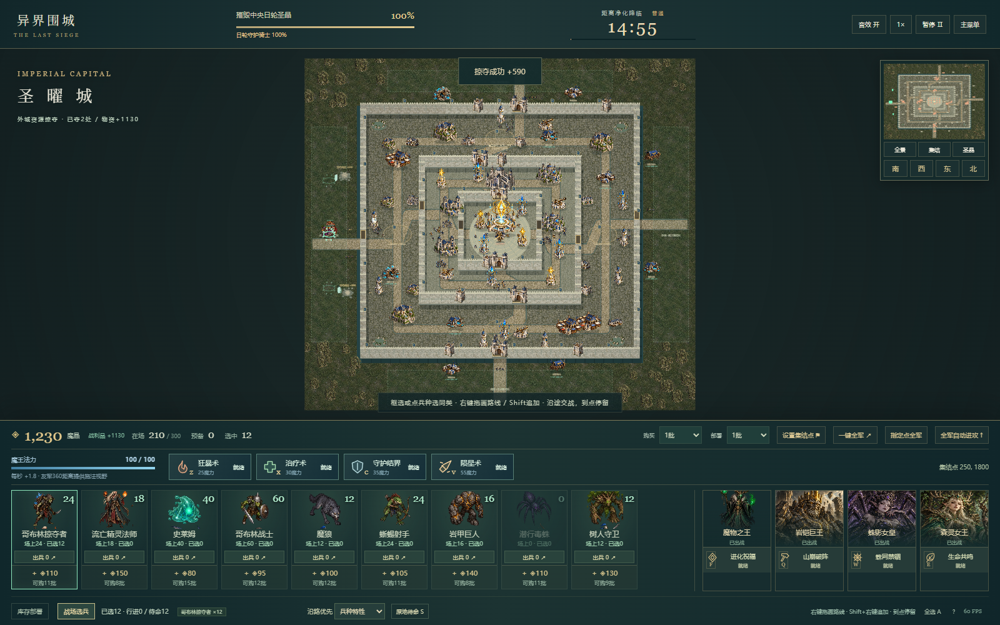
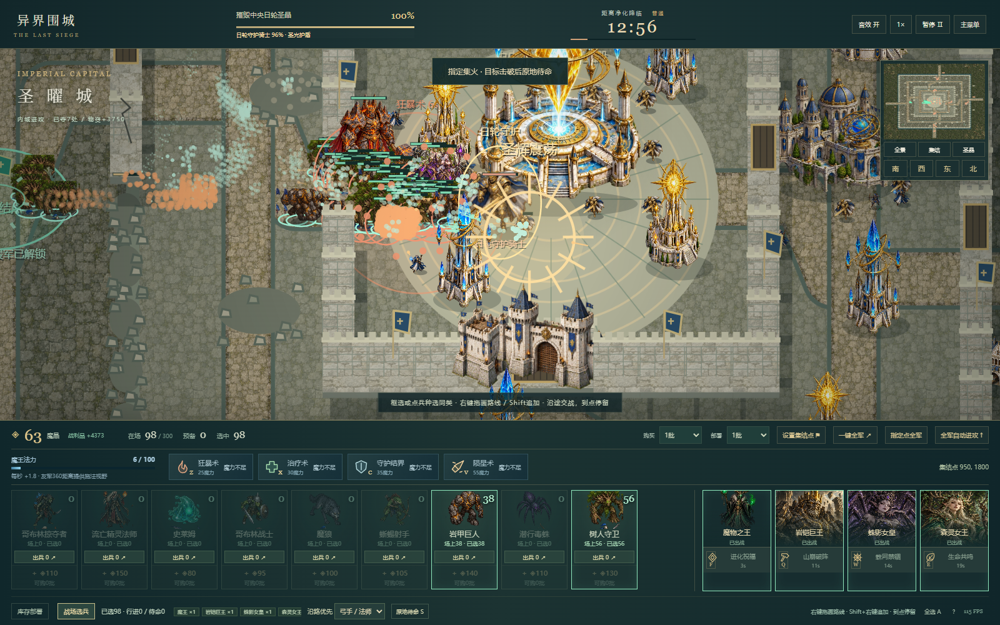
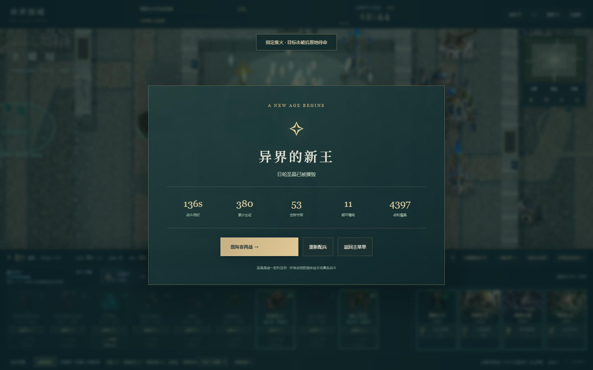

# V3.1 交付与真实验收

日期：2026-10-24。已完成本地生产与公开3.1.0验收。[立即游玩](https://liguanheng.github.io/SEAPP1/?v=3.1.0)。公开源提交5d4fdec2436220f49b2d71dc75fdbb2083841bcf，干净构建；19个发布文件SHA-256全部一致。

## 本轮交付

外城掠夺→购入援军→拆除火力与占前线→内城决战。资源运输车360/军需450/矿场500/仓库600，掠夺者击毁额外90；初始军费简单3200、普通2800、困难2500，18/15/15分钟。没有强制先清资源，胜利仍只看中央5600HP圣晶。

新部署待命，底栏库存/战场选兵分开，单选/框选/双击同类/卡片同类与Shift追加。右键拖画轨迹、Shift追加、沿途优先级、回归路线、终点停下和S停止；保留长按、批量、一键出兵及编队。长路点追加保留新终点，高大建筑前方守军可以正确点击。

箭塔420、炮500–540、防空460–480射程，内城和核心覆盖邻街但不能打遥远营地；高台只能越本环近墙，其他环墙/建筑仍遮挡。安静方向有限实体沿路支援，留最低驻军。核心驻军10/16/18，另有日轮守护骑士2400/3200/4000HP、125体型、震荡/定身/阶段护盾。法术、统帅、破墙及据点增援均参与真实战斗。

## 实际验证

- 单元/局部模型：87/87，包括原67项及20项新指挥/城防测试。局部隔离测试不作为整场胜例。
- 生产Chrome指挥：9/9。验证出兵待命、战场卡选择、右键绘线、Shift追加、优先级、S、核心HUD、720p与无脚本异常。
- 生产Chrome完整战役：10/10。真实菜单整备、分队掠夺、路线到达停留、购买、前线部署、技能与最终胜利，另验证真实超时和两种结算重开。最终136.67仿真秒，累计部署380、损失300、战利4397；前线新购部署有13次坐标/队列证据。
- 构建：严格TypeScript检查与Vite生产构建通过，19个发布文件。公开源SHA与19文件SHA-256已全部核验一致。

浏览器所有战斗操作通过DOM按钮、键盘与鼠标执行。仿真快进调用同一Battle.advance，不改HP、钱包、单位或结算状态。超时测试保留整备库存等待自然时间条件；性能按真实墙钟采样。没有冒充真人实时试玩。

## 合法预算战术样本

seed=20261024，群山破城，进化专精。raid控制器会分队夺外围物资、购买、拆炮、占前线、使用手动技能，再攻核心；direct只投入初始全军自动推进，不追加购兵或施法。

| 难度 | 方法/方向 | 实际状态 | 仿真秒 | 圣晶HP | 夺取点/物资收入 | 存活 |
|---|---|---|---:|---:|---:|---:|
| hard | direct / west | battle | 70 | 5600 | 3 / 1630 | 0 |
| easy | raid / west | victory | 96.52 | 0 | 7 / 3750 | 136 |
| normal | raid / west | victory | 96.63 | 0 | 7 / 3750 | 129 |
| hard | raid / west | victory | 144.23 | 0 | 7 / 3750 | 17 |
| normal | raid / north | victory | 175.27 | 0 | 6 / 3310 | 70 |

困难四方向、seed20261024与42，共8个直推样本均初始军团耗尽且圣晶5600。有钱可再买兵，因此status仍battle，不能称已触发游戏自然失败；它说明不购兵、不指挥的这批全军推进没能获胜。并非保证任何数量或套路都不可能直攻成功。

苍穹突袭另测：

| 难度 | 方向 | 实际状态 | 仿真秒 | 圣晶HP |
|---|---|---|---:|---:|
| easy | west | victory | 102.63 | 0 |
| normal | west | victory | 94.18 | 0 |
| hard | west | defeat | 141.25 | 5600 |
| normal | north | defeat | 229.37 | 2941 |

普通两套阵容、两个方向存在胜例；困难已验证群山西线，苍穹困难西线和普通北线有失败，保留SKY_RESULTS，不宣称所有阵容可过。数据是有限样本，不能换算总体胜率。中间调参数结果TACTICAL_PROBE/FIRST_PASS不计最终通过。

## 性能与真实截图

Windows，32逻辑核、31.7GiB内存，HeadlessChrome155，1920×1080。本次300友军驻留10.00秒，平均144.4FPS，P95帧间隔5.7ms，超过50ms帧4个；实际交战10.00秒平均161.8FPS，P95 11.1ms，超过50ms帧1个，活动友军143–297、损失231、击杀8。

活动300驻留和动态战斗分别报告，后者不声称全程保持300。采样JS堆3.14MiB不含图片、Canvas/GPU与总进程内存；退出后Canvas为0、退休模型停止。Headless帧率只适用于本机与这两段采样，不作为显示器刷新率或低端电脑保证。

截图01路线预览、02核心驻军、03低分辨率、04主菜单、05外城经济、06据点补兵、07内城攻坚、08守护骑士、09胜利、10真实超时失败、11驻留300、12大军交战。均为实际运行截图，沿用原创图集，没有用生成画冒充战斗证据。

## 失败与限制

原3.0基线探测保留BASELINE_3_0及脚本，基线源码ba58d66（游戏a64c48f）；不能在当前源码重跑并仍称3.0。此基线的部分困难样本也失败，不能把用户试玩经历否定或臆造为本次完全重现。

首轮浏览器验收因新模式下未切回库存而没有部署第二队，另有购买按钮旧选择器错误；修正脚本后完成真实战役。一次真实胜利后脚本过早找结算按钮，已等待1.6秒演出。另一次只掠夺4处外围、未充分准备的真实战役在122.22秒失败，圣晶5558.4，累计336出征全失；补全外围掠夺、核对前线出兵坐标并修复建筑吞点击后，生产验收完成。失败截图debug-campaign保留；原始失败工具输出没有包装成通过报告。

当前依然需要更多真人、更多种子/阵容平衡验证；困难北向法师/炮火很危险。单位使用轻量分离，窄门仍可能拥挤；到点停留属于命令，不会自动追远处敌人，必要时继续下命令。美术沿用2D原创图集与程序化动作，没有新增逐帧全方向动画。未加入移动触控、中途存档或完整BGM。

## 历史与复现

37cd5aa为首个已验证指挥/城防/掠夺阶段提交，后续正常提交记录见Git。没有强推、重写历史或改时间。运行方式、课程设计和本轮验收映射已同步根目录及docs课程文档。当前默认npm run sim执行3.1；sim:legacy为旧3.0脚本，会写旧证据目录，仅用于对应源码历史复现。

公开发布已成功：[Actions 40076297945](https://github.com/LiGuanheng/SEAPP1/actions/runs/40076297945)。源代码提交5d4fdec2436220f49b2d71dc75fdbb2083841bcf，版本3.1.0，核验UTC 2026-10-24T08:01:24.367Z，19/19文件一致且无浏览器错误。公开验收真实经过菜单、6统帅选择/整备、方向切换和一键部署，数据见RELEASE_RESULTS.json，截图20-live-pages.png。37cd5aa与5d4fdec为本轮两个真实开发阶段；随后文档提交仅补发布证据，不重写或触发无关发布。
