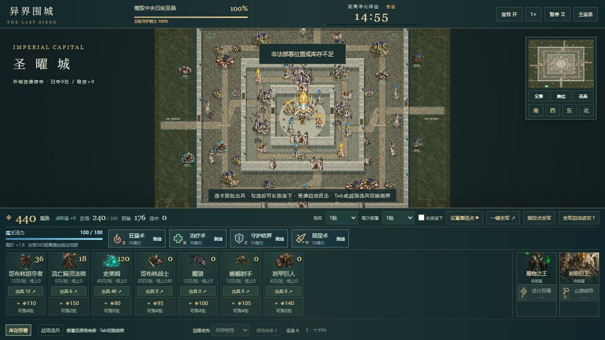
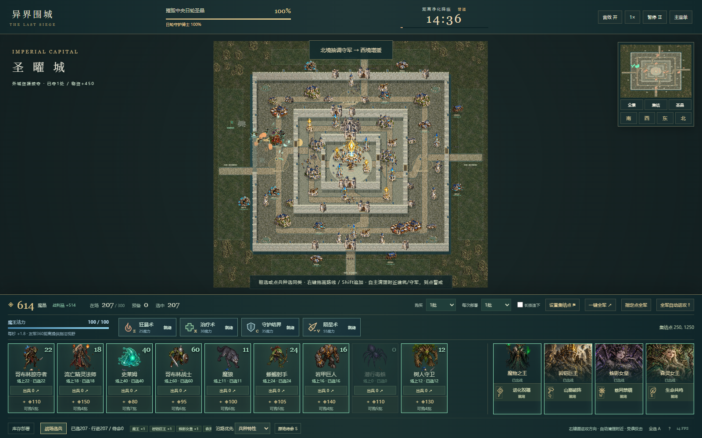
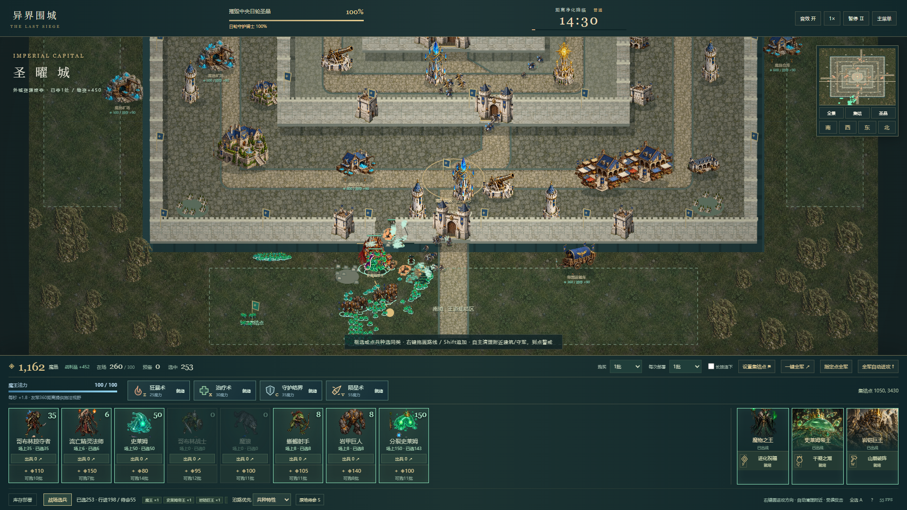

# V3.2 自主攻城与精确出兵

2026-10-24。根据用户最新反馈实际修复。当前生产与公开验收完成。[立即游玩V3.2](https://liguanheng.github.io/SEAPP1/?v=3.2.0)。公开版本3.2.0，源提交40a5289376ef57fec085f0c296d3d14f9d79390a，干净构建，19/19发布文件SHA-256一致。

## 现在的行为

- 轨迹表示大致进攻方向。部队会自主清理周边敌军、资源、军事与普通城区建筑；优先级影响先后，不能让部队只盯着线走。清理结束继续原路线，终点附近清完再警戒。
- 守军普攻、炮弹与范围伤害均保留真实来源。受到攻击时，本人与220范围近邻反击；保留原路线/集火，结束后继续。待命受袭也反击，之后归位；记忆与700局部追击边界防止被诱向全图。集火目标死亡不再清空尚未结束的防卫警报。
- 默认1批。点放、普通按住、拖放、快速按钮都严格遵守所选批数，Shift不再偷偷全下。哥布林1批20、3批60；明确选择全部库存/全军按钮才会全投。
- 长按连下默认关闭；勾选后，600ms开始、每500ms投一次当前批数，松开/暂停/失焦/取消立即结束。保留队列与300上限，不重复扣钱。
- 修复精灵对大建筑边缘反复取消咏唱：前摇和普攻一致采用矩形表面射程。保留真实LOS和墙体碰撞，不用隔墙攻击伪装智能。

## 真实验证

100/100模型测试通过。新增/更新覆盖侧向城区/资源、终点清理、真实箭手/塔弹反击、近邻支援、警戒归位、路线/集火恢复、目标死亡防卫记忆、局部追击边界、精确批数及共享寻路。

实际Chrome交互13/13：默认1批/连投关闭；普通按住1.2秒只下20；Shift卡片/地图/快捷不全下；3批快捷60；原生拖放20且保留库存；勾选后850ms只下40并在释放后停止；明确全部库存、非法位置不扣库存、720p布局；真实画出的方向没有指定民居，却自动造成其伤害；实际敌军攻击触发本人及近邻警报；无页面异常。

生产完整战役10/10：真实菜单、配兵、分队掠夺、行进/到达、购兵、前线占领、10次有坐标/队列证据的新购前线部署、手动技能、圣晶自然归零、胜利重开、真实超时失败和失败重开。该场201.38仿真秒，累计330出征、219损失、22次购买；圣晶0、status=victory。没有调用胜利函数或覆盖资金/HP。

浏览器战役只读模型计划，通过DOM/键鼠执行动作。长战斗使用同一Battle.advance快进，不冒充真人实时盲测。单元测试隔离对象和布局以验证局部机制；完整战役保持原地图、预算与伤害。

## 路线性能缺陷与实际修复

首次明确绘线进攻只有13.03FPS，记录pass=false保留PERFORMANCE_ROUTE_FIRST_PASS.json。定位到每个终点阵型位置触发独立Dijkstra目的地，48场缓存发生抖动；同时终点交战重复逐帧搜索。修复为无遮挡直行、受阻共享路点、战斗按错峰思考时钟更新，并添加300单位无遮挡/受阻共享用例。没有降低单位数量或把战斗静止截图冒充性能。

Windows，32逻辑核、31.7GiB内存，1920×1080，HeadlessChrome155，各段实际墙钟约10秒：

| 场景 | 秒 | 平均FPS | P95帧间隔ms | >50ms帧 | 活动友军范围 | 损失/击杀 |
|---|---:|---:|---:|---:|---:|---:|
| 300驻留 | 10.01 | 70.8 | 22.2 | 1 | 300–300 | 0/0 |
| 方向进攻 | 10.01 | 52.3 | 27.9 | 5 | 255–300 | 47/2 |
| 自动攻城 | 10.00 | 76.2 | 22.3 | 2 | 132–258 | 197/15 |

驻留段用S明确待命，避免将新版右键进攻误作原地站立；方向段使用真实鼠标绘线。后两段随战损变化，不声称全程固定300。JS堆6.75MiB不包括图片、Canvas/GPU与进程总内存；退出战场Canvas为0、退休模型停止。Headless帧率只描述本机样本，不外推到所有设备或真人显示刷新率。

## 合法预算战术回归

最终模型种子20261024；raid分兵掠夺、购买援军、拆炮/占点、施法和决战，direct仅初始军团自动推进。控制器在部分外围队伍转为自主交战后不再无限等待固定资源数，最多准备到120秒再继续；此为测试战术，游戏从来没有资源数量/时间推进门槛。

| 难度 | 方法/方向 | 实际状态 | 仿真秒 | 圣晶HP | 资源点/收入 |
|---|---|---|---:|---:|---:|
| hard | direct/west | battle | 72.25 | 5600 | 2/1090 |
| easy | raid/west | victory | 153.67 | 0 | 4/2310 |
| normal | raid/west | victory | 162.87 | 0 | 4/2310 |
| hard | raid/west | victory | 173.58 | 0 | 4/2310 |
| normal | raid/north | victory | 185.38 | 0 | 6/3450 |

另有困难四面直推样本DIRECT_20261024.json，均初始军团耗尽、圣晶5600。因为仍有资金可买兵，status=battle，不能冒充游戏已自然失败。胜例与败例只是这些明确策略/种子，不是所有阵容的统计胜率。部分胜利时守护骑士还活着，符合唯一胜利条件为圣晶归零，不设置强制全清。

## 截图与复现






所有截图来自本项目实际运行，沿用合法原创图集，没有生成画冒充战斗。课程GDD/SRS/SDD、手册、矩阵、开发与决策记录已同步最新行为；V3.1证据目录保留，未被本次脚本覆盖。

```sh
npm test -- --reporter=json --outputFile=docs/v3.2/UNIT_RESULTS.json
npm run build
npm run preview -- --host 127.0.0.1 --port 4173
npm run test:e2e -- http://127.0.0.1:4173/SEAPP1/
npm run sim
npx tsx scripts/tactical-simulate.ts --sweep
node scripts/verify-release.mjs https://liguanheng.github.io/SEAPP1/ EXPECTED_SHA
```

## 限制与历史

路线是进攻命令，会优先处理攻击者；没有新增忽略攻击的强制移动模式。范围受真实地形/视线约束，不会无界追杀。人群用轻量分离，窄门仍可能拥挤；大规模路径初次计算和建筑连续破坏仍可能产生长帧。仍需要更多真人、更多阵容与低端硬件验证。

首轮测试报告曾因把trace对象自身加入trace产生循环序列化错误，修复后重跑；新增寻路用例最初沿用旧导航缓存/把可攻击城区当纯障碍，修正隔离场景与索引后验证，未降低功能断言。首轮低帧率保留为失败，未当作通过。cd738e1为已验证97模型/13真实交互的首阶段提交，后续继续正常提交/推送，不重写历史。

GitHub Pages已发布3.2.0，[Actions 40099628543](https://github.com/LiGuanheng/SEAPP1/actions/runs/40099628543)构建、测试、部署均成功。公开源SHA 40a5289376ef57fec085f0c296d3d14f9d79390a，独立Chrome实际整备/部署、19文件全部哈希一致、无页面错误，原始数据RELEASE_RESULTS.json，截图20-live-pages.png。阶段提交cd738e1和40a5289已正常快进合入main；随后文档提交只补真实发布证据，不重写历史。
