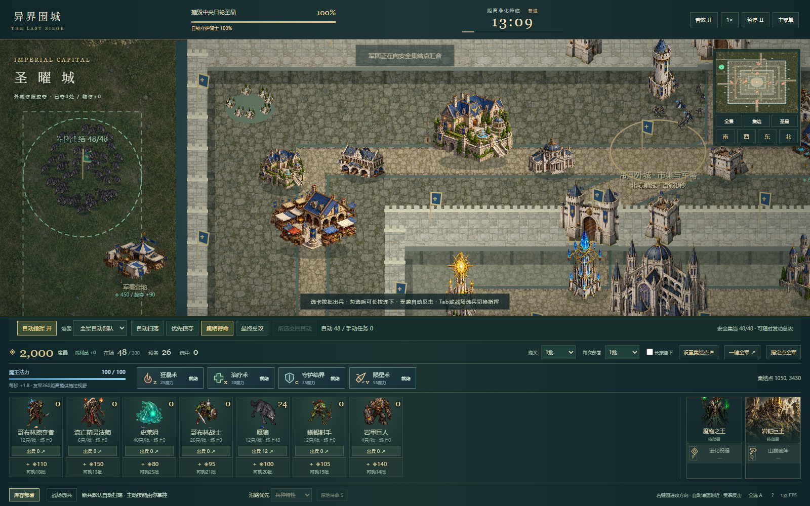
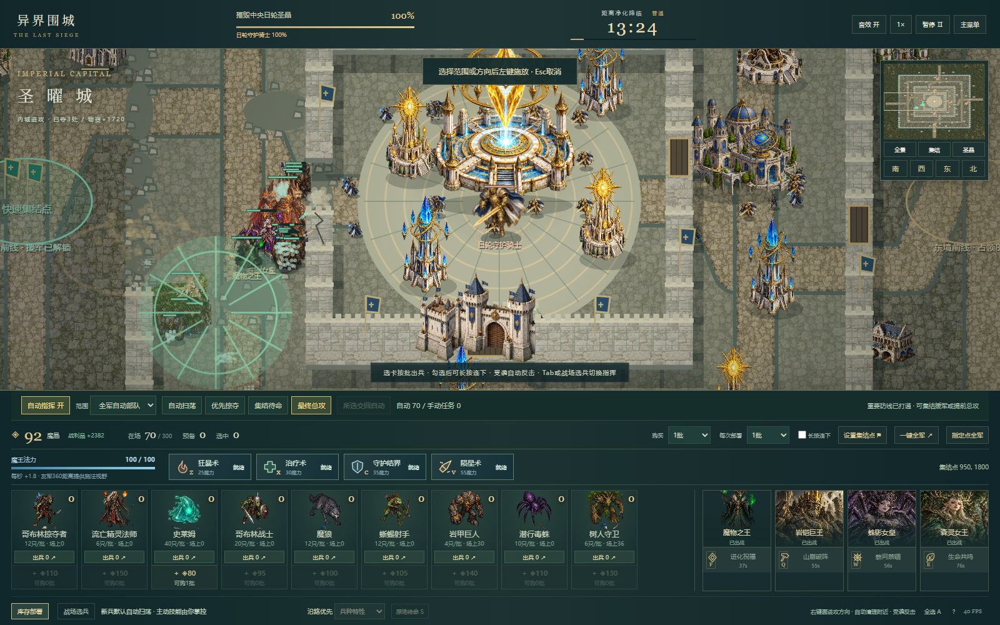
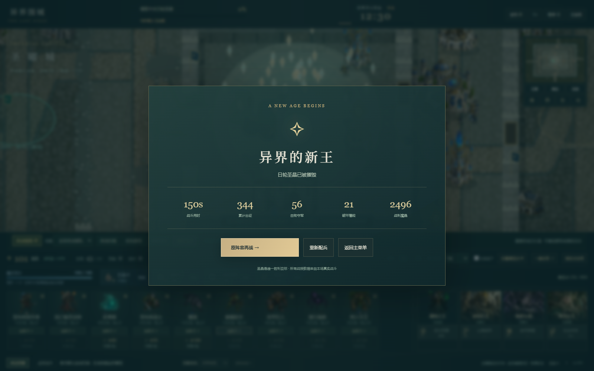

# V4.0 智能军团实际交付与验收

本轮在V3.2四层圣曜城上实际开发：默认自动作战、四军团命令、安全集结、兵种角色、独立手动任务保护、共享规划与真实性回归。玩家负责配兵、部署、增援、战略命令和关键技能。规则AI没有大模型API，也没有自动购买或自动施放主动技能。

[在线游玩](https://liguanheng.github.io/SEAPP1/?v=4.0.0) · [源码](https://github.com/LiGuanheng/SEAPP1) · [操作手册](../USER_MANUAL.md)

## 功能与边界

| 指挥 | 实际行为 |
|---|---|
| 默认自动扫荡 | 保留部署方向，分队逐层处理守军、军事设施、重要物资和通行障碍；不强制拆尽民居 |
| 优先掠夺 | 掠夺者锁定可达资源，普通战斗兵护卫清敌；收益真实结算一次 |
| 集结待命 | 点击己方安全区，地面走真实连通路径，空军绕防空风险；显示旗帜和到达数；危险变化可换安全点，不通则警戒提示 |
| 最终总攻 | 可随时发动，沿方向和已有缺口直推中央目标；不以外围全清作前置 |
| 手动结合 | 自动/手动开关，范围选择全军自动部队/仅所选；单兵、框选、编队的手动路线/集火/S停留保持独立，明确交回自动才恢复AI |

史莱姆/哥布林局部清敌推进；掠夺者可达资源优先；巨人破墙、已有缺口优先且拥挤时可拓宽；狼/狼骑优先附近弓法；精灵按敌群密度选目标并保持距离；树人跟随受伤主力治疗；飞龙检查目标与路径上的防空风险，无地面支援可在安全处等待并提示。统帅自动普攻，主动技能仍由玩家决定。

自动与手动都受真实射程、阵营、攻击类型、LOS和碰撞约束。原有十二兵种、三专精、六统帅、四法术、四前线、战中购买继续保留。默认1批、1/3/5/10/全部及显式长按连投保持原有精确库存账本。

## 自动化与真实浏览器

- 模型测试：**120/120通过**。原100项回归保留，新增20项军团测试；旧待命用例明确改在手动模式执行，不将它冒充新默认。
- Chrome生产预览指挥交互：**13/13通过**。真实菜单、精确12掠夺者部署、无右键真实掠夺、全军/所选范围、手动任务保留、自动切换与1280×720界面。
- 四面共48魔狼实际到达西北安全集结点：**48/48**，最远约147像素，零损失、零破墙。不是瞬移或修改单位坐标。
- 少操作浏览器战役：**10/10通过**。普通/群山破城/西境，自然胜利于150.52模拟秒，19次按预算购买、10次前线部署、8次玩家主动技能；全过程没有路线或指定目标命令（独立手动部队数始终0）。
- 该战役摧毁21段墙，掠夺3处/资源收入1720，部署344、损失301。玩家先请求集结，再请求最终总攻；没有免费兵、无限技能或覆盖核心生命。
- 胜利重试、真实超时失败、失败重试均通过。脚本用实际按钮与地图点击施法；长战役调用同一个固定60Hz模型快进，**不等同真人实时盲测**。超时样本等待模型自然超时，不直接设置失败。

原始数据：[UNIT_RESULTS](UNIT_RESULTS.json)、[ORDERS_BROWSER](ORDERS_BROWSER.json)、[CAMPAIGN_BROWSER](CAMPAIGN_BROWSER.json)。单位隔离测试有意移除敌军或设置几何场景，不能被当作完整通关证据。

## 最终代码合法预算战役样本

固定种子20261024，仅合法购买、选择部署位置及最多8次脚本玩家技能，不发路线/集火命令。sky在100秒请求一次总攻；其他样本使用默认扫荡。脚本不是游戏运行时自动购买/施法功能。

| 难度 | 阵容 / 方向 | 结果 | 模拟时长 | 购买 / 玩家技能次数 | 剩余核心HP |
|---|---|---|---|---|---|
| normal | breach / west | victory | 92.97秒 | 16 / 6 | 0 |
| normal | breach / north | victory | 101.27秒 | 18 / 6 | 0 |
| normal | sky / west | victory | 125.67秒 | 20 / 7 | 0 |
| hard | breach / west | victory | 95.32秒 | 17 / 8 | 0 |
| normal | wrong / south | defeat | 69.55秒 | 9 / 0 | 5600 |

breach为群山破城，sky为空地混合；wrong为召唤专精、帝王及纯史莱姆从南门进攻，持续合法补买基础兵仍全军覆没。这说明存在可行多样打法与错误配置败例；五个固定样本不是统计胜率，也不保证任何种子或操作都必胜。证据：[AUTO_CAMPAIGNS](AUTO_CAMPAIGNS.json)。

## 300单位真实性能

win32、32逻辑核心、31.7GiB RAM、Headless Chrome155、1920×1080。依次实际墙钟10秒，统计requestAnimationFrame间隔，无快进或改HP。每阶段都报告真实存活范围，后段战损后不再假称固定300。单次测试受主机负载影响，不能作为所有硬件的帧率承诺。

| 阶段 | 活动友军范围 | 采样秒 | 平均FPS | P95帧间隔ms | >50ms帧数 |
|---|---|---|---|---|---|
| 300驻留 | 300–300 | 10.01 | 72.3 | 16.8 | 1 |
| 自动扫荡 | 299–300 | 10.01 | 70.2 | 17.5 | 2 |
| 优先掠夺 | 285–300 | 10.01 | 55.2 | 27.8 | 8 |
| 最终总攻 | 172–284 | 10.00 | 80.2 | 16.8 | 6 |

末尾JS堆约19.8MiB（不包括图片解码/GPU）。无浏览器错误；回菜单后canvas=0、旧战斗时间停止。军团规划于45.92模拟秒内共47次，按约1秒间隔更新；新兵接入既有计划，避免每召唤一只就全图重算。48场共享导航缓存、40px连通分量、320px建筑索引、单位空间桶、错峰局部索敌和目标滞后限制搜索。少量分裂史莱姆死亡后产生一个小体是原有兵种被动，计入deployed并受300上限；这不是军团AI自动付费召唤。自动技能/法术计数均0。

[PERFORMANCE_RESULTS](PERFORMANCE_RESULTS.json)保存完整计数、阶段实际损失和机器信息。

## 实际问题与修复

1. 首轮真实集结只有37/48到达：保守栅格将墙角实际可行位置误判为断路，安全场对角移动又可能切角。增加可见自由格映射、禁止安全路径切角并允许碰撞滑移；最终模型/真实浏览器均48/48。保留[ORDERS_BROWSER_FIRST_PASS](ORDERS_BROWSER_FIRST_PASS.json)。
2. 掠夺者每秒重排行走目标造成摇摆：锁定可达资源至死亡/失去可达性，保留首轮失败[UNIT_FIRST_PASS](UNIT_FIRST_PASS.json)与旧策略样本[AUTO_FIRST_PASS](AUTO_FIRST_PASS.json)。
3. 已开相邻缺口后仍敲完整墙：让已开通路替代旧破墙承诺，增加独立回归；拥堵局部巨人可扩宽。
4. 空军局部索敌/反击会绕过战略防空筛选：目标与路径统一防空判断，地面支援/残血塔可以协同压制；集结空军使用独立危险路径。
5. 连续召唤导致全军规划频繁重启：新兵接入缓存计划，补测300兵连续入场5秒规划不超过7次。
6. UI明确作用域、选中自动/手动数、安全集结到达数和空军等待原因。已检查720p与实际内城截图，未用概念图冒充运行画面。

## 截图





[全部12张本地实际截图](../screenshots/v4.0)。截图中HUD计数来自拍摄时刻；单张FPS读数不替代上方10秒采样。

## Git与部署

- 基线96598c8，保留全部已有历史。
- 阶段一a6168be：默认自动军团、角色、指挥所有权/作用域、四军团命令、导航与首批真实交互。
- 阶段二：真实少操作通关、300自动性能、空地集结与缺口修复、课程资料和报告（本报告所在源代码提交）。
- 发布状态待完成公开部署后追加精确源SHA、Actions及逐文件验证，未把本地运行当作线上发布成功。

复现（预览服务在一个终端常驻，浏览器测试在另一个终端运行）：

```sh
npm ci
npm test
npm run format:check
npm run build
npm run preview -- --host 127.0.0.1 --port 4186
npm run test:e2e -- http://127.0.0.1:4186/SEAPP1/
npm run sim
```

代码与生成数据保留，模型长战役会花费CPU时间；真实性能应单独运行以减少竞争。

## 仍有实际限制

规则AI属于有界启发式，分两队/按前线规划，尚非全局最优战术搜索。孤立空军可能等待地面协同，需要玩家改变方向/购兵/手动覆盖；被完整城墙隔开的集结单位会明确等待通路。极端窄缺口可局部拥挤，未实现大型刚体拥挤求解器。美术复用已有原创图集，动作仍两姿态配合程序化变形；本轮没有新生成角色。没有移动触控适配、中途存档、完整BGM或第三方真人平衡盲测。
